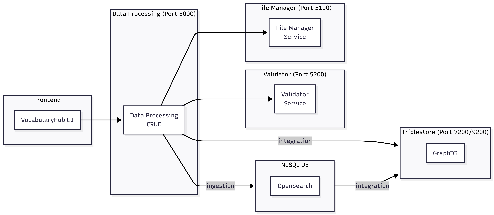
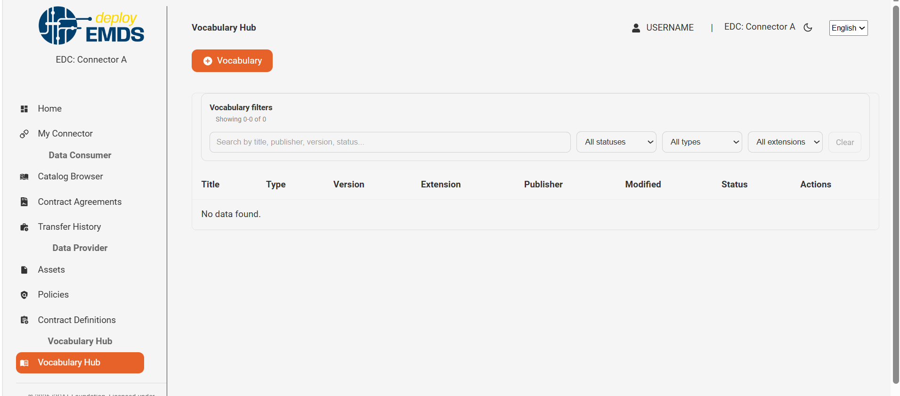
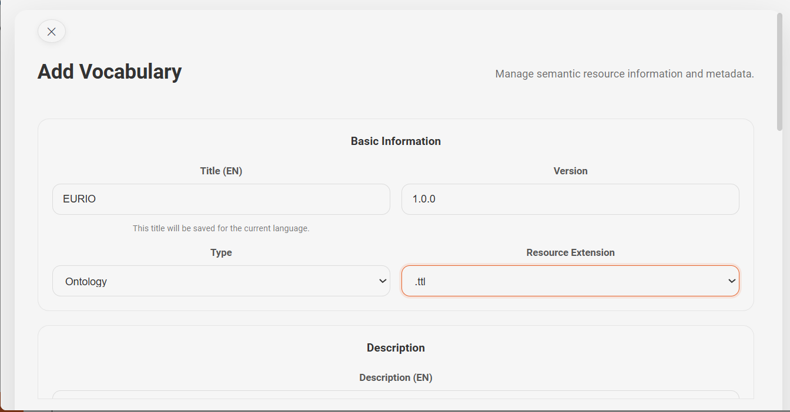
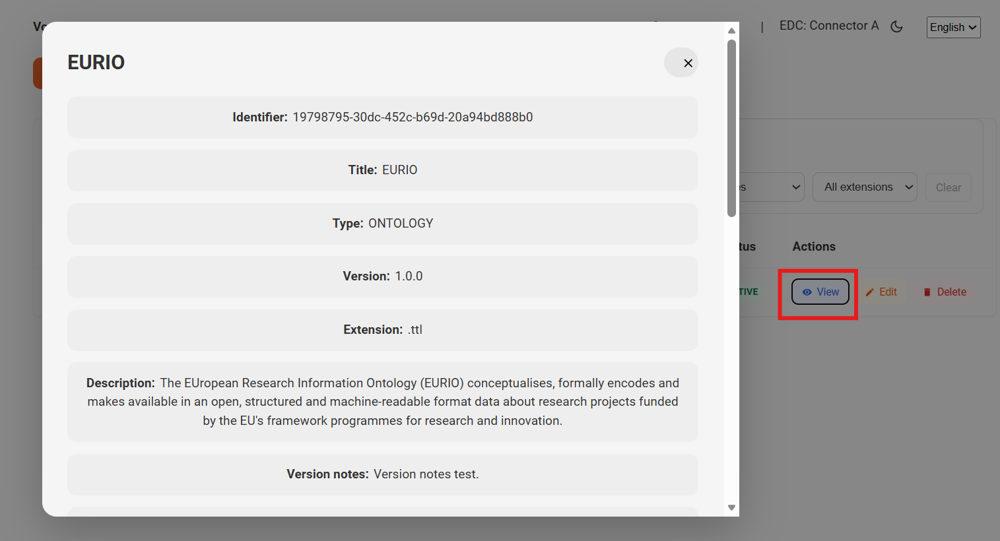
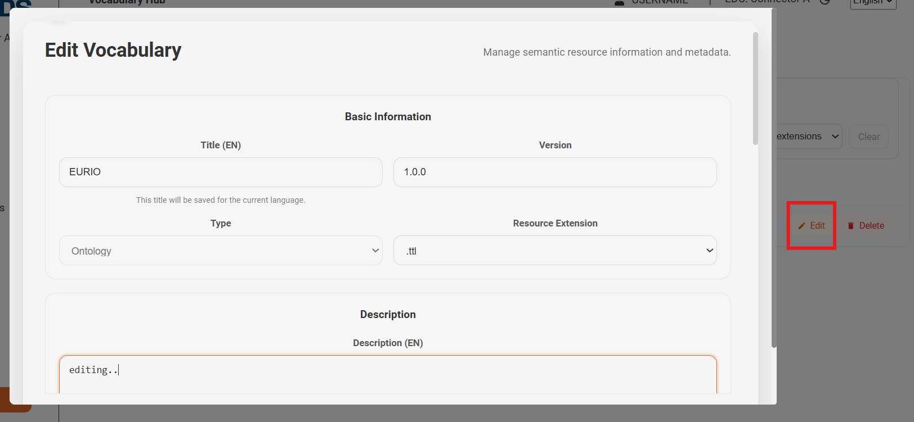
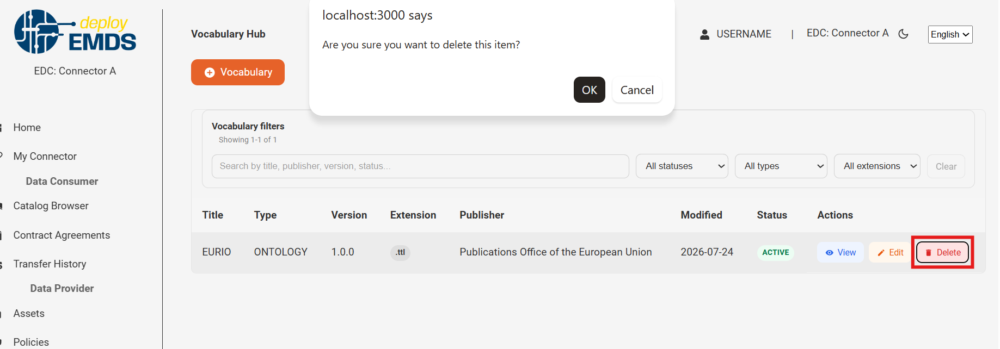
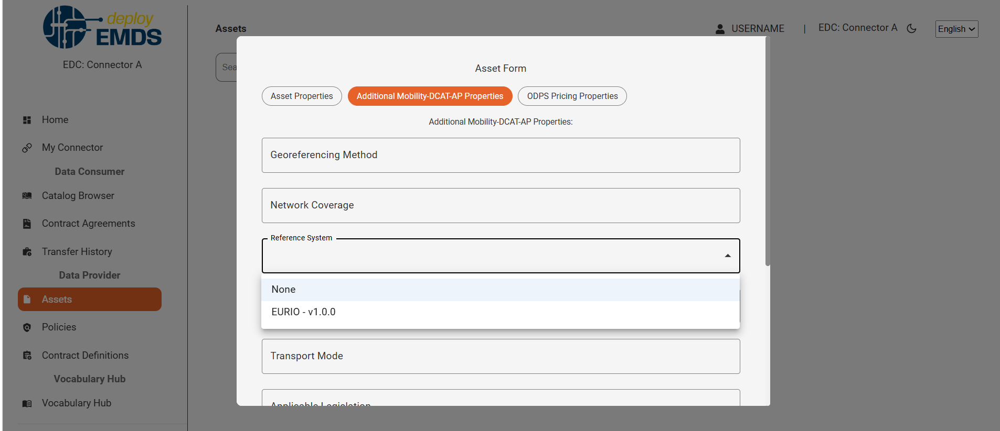

# Microservice DATA PROCESSING

This repository provides the Data Processing API focused on **VocabularyHub** and **Controlled Vocabularies**.

By default, the API is exposed at:
`http://127.0.0.1:5000/data-processing/v1/`

Host and port are configurable through environment variables.

---

## Architecture

The diagram below shows how the Data Processing microservice fits into the broader platform and how its internal components are organised.


---

## Current scope

This microservice currently supports:

- VocabularyHub ingestion + integration flow
- VocabularyHub metadata update and versioned edit
- VocabularyHub metadata query and deletion
- Controlled vocabularies import, list, entry retrieval, delete, and auto-import
- Health-check endpoint

Removed capabilities (for example `CatalogDatasets` CRUD and DCAT/ODRL integration endpoints) are no longer part of this service.

## Main endpoints

Base path: `http://localhost:5000/data-processing/v1`

### VocabularyHub endpoints

- `POST {API_BASE}/VocabularyHub/create_resource` - ingest and integrate one semantic resource
- `PUT {API_BASE}/VocabularyHub/update_resource` - update metadata of an existing resource
- `POST {API_BASE}/VocabularyHub/edit_metadata` - create a new version from an existing resource with partial metadata patch
- `GET {API_BASE}/VocabularyHub` - list resources (pagination and filters)
- `GET {API_BASE}/VocabularyHub/{resource_id}` - get one resource by UUID
- `GET {API_BASE}/VocabularyHub/versions/by-name?resource_name=...` - list versions of a resource by name
- `DELETE {API_BASE}/VocabularyHub/{resource_id}` - delete a resource by ID

### Controlled vocabularies endpoints

- `POST {API_BASE}/ControlledVocabularies/import`
- `POST {API_BASE}/ControlledVocabularies/auto-import`
- `GET {API_BASE}/ControlledVocabularies`
- `GET {API_BASE}/ControlledVocabularies/{vocab_name}`
- `DELETE {API_BASE}/ControlledVocabularies/{vocab_name}`

### Health-check endpoint

- `GET {API_BASE}/health-check`

## Validation and localization highlights

### Controlled vocabulary validation

`FieldVocabularyValidationService` validates profile-configured fields before persistence.

- input may be either a code or an IRI
- valid codes are normalized to canonical IRIs
- invalid values fail the request with validation errors

### VocabularyHub validation

`VocabularyHubValidationService` validates semantic resource fields used by ingestion and metadata update flows:

- `type`
- `resource_extension`
- `spatial` or `geographical_coverage`
- `language`
- `theme`
- `frequency`
- `status`

### Localized GET responses

When a supported endpoint receives `lang`, `LocalizedResponseService` can:

- filter multilingual fields such as `preferredLabel` and `description`
- translate configured controlled vocabulary values from codes or IRIs into localized labels

### Controlled vocabulary bootstrap

`controlled_vocabularies_bootstrap.py` can auto-import vocabularies from the resources folder at startup.

Key behaviors:

- supports explicit selection or profile-based selection
- skips vocabularies that already exist in the target graph
- routes vocabularies to custom, EU, IANA, or W3 graphs
- materializes `odrl22.rdf` into `rule_actions`, `constraint_left_operand`, and `constraint_operator`
- the same flow can be executed on demand through `POST /ControlledVocabularies/auto-import`

---

## User guide

This section provides a visual walkthrough of the main frontend workflows. The screenshots capture the **Connector UI**, where the user interacts with the VocabularyHub forms and related CRUD actions.

### 1 – Connector home / entry point

The Connector application is the main frontend entry point. From here, users can navigate to the VocabularyHub UI and start creating or managing vocabularies.



> Main landing page for the Connector UI.
> This is where we can find the list of the existing vocabularies.

---

### 2 – Creating a new resource



> Resource creation form inside the Connector UI.
> This is where users upload or register a new vocabulary resource.

---

### 3 – Viewing a single resource



> Detail view for one VocabularyHub resource.
> Useful for checking the stored metadata and the current version.

---

### 4 – Editing metadata (versioned)



> Metadata edit form for an existing resource.
> Saving changes creates a new version instead of overwriting the original record.

---

### 5 – Deleting a resource



> Confirmation or action area for removing a resource.
> Use this option only when the resource should no longer be available in the hub.

---

### 6 - Vocabulary/Asset link

Those vocabularies can be linked to assets in the platform through the attribute `Reference System`. The following screenshot shows the link between a vocabulary and an asset.



---

## Technologies

The following technologies are used in this project:

- FastAPI
- OpenAPI, available at `/data-processing/v1/docs` and `/data-processing/v1/redoc`
- Pybuilder for tests and packaging tasks
- Docker for local execution and deployment

## Environment documentation

Environment variables are defined in the `.env` file.
Examples: [Environment configuration](docs/environment_config.md)

## Getting started

### Pydoc

Consult the Pydoc documentation about project modules, classes, functions, and methods exported to HTML files.

#### Generate Pydoc

##### Generate HTML files

- `python -m pydoc -w <file_name_or_project_path>`

##### Serve the documentation browser

- `python -m pydoc -b`

Terminate the service by pressing `q`.

### Prerequisites

Docker execution:

- Docker Engine v20.10.17
- Docker Compose v2.6.1

Manual execution:

- Python 3.12.3
- Pip 25.1.1
- Install dependencies with `pip install -r .\requirements.txt`

### Dependencies to other resources

- File Manager and Validator microservices must be available
- Elasticsearch or OpenSearch must be available
- GraphDB, Fuseki, or Neptune must be available depending on `TRIPLESTORE_BACKEND`

### Start microservice

Option A: run `src\dev\wsgi.py` from the IDE.

Option B: run from a terminal:

```shell
python src\dev\wsgi.py
```

## Running the tests

All project functions have associated unit tests to verify behavior.

### Configuration files

- JSON schema files can be adjusted to generate models dynamically.
- Template-driven SPARQL queries can be adjusted depending on the schema files.
- Elastic mapping, RML mapping, and SHACL validation files can be adapted to field changes.
