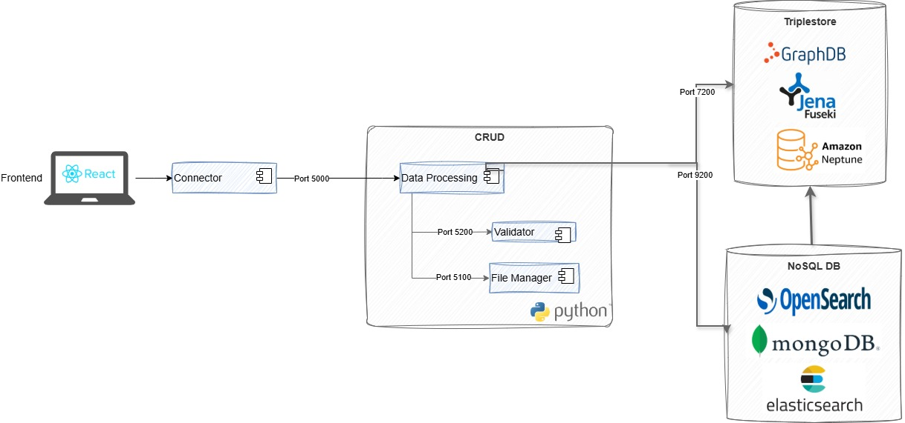

# GENERAL CONTEXT

The `data_processing` microservice is part of the Data Space Builder backend. It orchestrates ingestion and integration flows and exposes CRUD REST APIs for DCAT, FOAF, ODRL, Participants, and controlled vocabularies.

See for backend components and flows.

 

# INTERNAL ARCHITECTURE

## Microservice endpoints

Base path: `/data-processing/v1`

### Orchestration endpoints

- `POST /VocabularyHub/create_resource`
- `PUT /VocabularyHub/update_resource`
- `GET /VocabularyHub`
- `GET /VocabularyHub/{resource_id}`
- `DELETE /VocabularyHub/{resource_id}`
- `POST /CatalogDatasets/dcat_odrl_integration`
- `PUT /CatalogDatasets/update_dcat_odrl`
- `GET /health-check`

### CRUD endpoints

Prefix: `/CatalogDatasets`

- Catalogs
  - `POST /catalogs`
  - `GET /catalogs/{catalog_id}`
  - `PUT /catalogs/{catalog_id}`
  - `DELETE /catalogs/{catalog_id}`
  - `GET /catalogs`

- Datasets
  - `POST /datasets`
  - `GET /datasets/{dataset_id}`
  - `PUT /datasets/{dataset_id}`
  - `DELETE /datasets/{dataset_id}`
  - `GET /datasets`

- Distributions
  - `POST /distributions`
  - `GET /distributions/{distribution_id}`
  - `PUT /distributions/{distribution_id}`
  - `DELETE /distributions/{distribution_id}`
  - `GET /distributions`

- Dataset Offers
  - `POST /datasetoffers`
  - `GET /datasetoffers/{offer_id}`
  - `PUT /datasetoffers/{offer_id}`
  - `DELETE /datasetoffers/{offer_id}`
  - `GET /datasetoffers`

- Agents
  - `POST /agents`
  - `GET /agents/{agent_id}`
  - `PUT /agents/{agent_id}`
  - `DELETE /agents/{agent_id}`
  - `GET /agents`

- Participants
  - `POST /participants`
  - `GET /participants/{participant_id}`
  - `PUT /participants/{participant_id}`
  - `DELETE /participants/{participant_id}`
  - `GET /participants`

- Data Services
  - `POST /dataservices`
  - `GET /dataservices/{dataservice_id}`
  - `PUT /dataservices/{dataservice_id}`
  - `DELETE /dataservices/{dataservice_id}`
  - `GET /dataservices`

- Policies
  - `POST /policies`
  - `GET /policies/{policy_id}`
  - `PUT /policies/{policy_id}`
  - `DELETE /policies/{policy_id}`
  - `GET /policies`

- Policy Templates
  - `POST /policytemplates`
  - `GET /policytemplates/{policy_template_id}`
  - `PUT /policytemplates/{policy_template_id}`
  - `DELETE /policytemplates/{policy_template_id}`
  - `GET /policytemplates`

### Controlled vocabularies endpoints

Prefix: `/ControlledVocabularies`

- `POST /import`
- `POST /auto-import`
- `GET /`
- `GET /{vocab_name}`
- `DELETE /{vocab_name}`

Compatibility route:

- `/VocabularyHub/ControlledVocabularies`

## End-to-end flows

### Participant create or update flow

1. FastAPI validates the payload with `ParticipantCreate` or `ParticipantUpdate`.
2. `ParticipantService` checks duplicate identifiers by notation and optional identifier scheme.
3. `FieldVocabularyValidationService` validates configured participant fields against the active controlled vocabulary profile.
4. Valid code values are normalized to canonical IRIs before persistence.
5. `ParticipantService` builds a temporary RDF graph and validates it against the participant SHACL shapes through the validator service.
6. `ParticipantRepository` writes the participant to the triplestore.
7. Reads can be localized by `LocalizedResponseService` when `lang` is provided.

### Participant read flow with localization

1. The repository returns the participant entity.
2. `LocalizedResponseService` filters multilingual fields such as `preferredLabel` and `description` to the requested language, with fallback to the configured fallback language.
3. The same service resolves configured controlled vocabulary values from code or IRI into the localized label returned by `ControlledVocabularyService`.
4. The API returns a user-facing localized response.

For participants, localized translation currently affects:

- `classification`
- `purpose`
- `address.admin_unit1`
- `address.admin_unit2`
- `address.post_code`

### Controlled vocabulary import flow

1. FastAPI receives `download_url` or uploaded `file` input.
2. `fastapi_controlled_vocabularies.py` decides whether the source is RDF, tabular XML, IANA media types XML, or the ODRL special case.
3. `controlled_vocabulary_importer.py` parses the payload and generates normalized triples.
4. `resolve_vocabulary_origin` selects the semantic origin unless `graph_iri` explicitly overrides it.
5. `ControlledVocabularyService` persists the vocabulary metadata and graph content.
6. `GET /ControlledVocabularies/{vocab_name}` returns paginated, language-aware entries.

Special cases:

- tabular XML imports use `dct:identifier` as code predicate
- RDF imports default to `skos:notation`
- IANA media types are routed to the IANA graph
- `odrl22.rdf` materializes `rule_actions`, `constraint_left_operand`, and `constraint_operator`

### Controlled vocabulary bootstrap flow

`controlled_vocabularies_bootstrap.py` can import vocabularies automatically during startup.

Behavior:

- enabled by configuration
- selection can be explicit or profile-driven
- existing vocabularies are skipped, so the process is idempotent
- vocabularies are routed to custom, EU, IANA, or W3 graphs
- `odrl22.rdf` is expanded into the three derived vocabularies required by ODRL validation and localization

On-demand trigger:

- `POST /ControlledVocabularies/auto-import` runs the same bootstrap sequence used at startup (`wait_for_triplestore` + `run_auto_import`) and allows manual re-import when required.

## Validation architecture

### Profile-based field validation

`FieldVocabularyValidationService` loads the active profile from `CONTROLLED_VOCAB_PROFILES`.

Important profile mappings include:

- `Participant.classification` -> `organizationtypes-eu`
- `Participant.purpose` -> `government-functions`
- `Participant.address.admin_unit1` -> `countries` or `countries-eu`
- `Participant.address.admin_unit2` -> `provincias`
- `Participant.address.post_code` -> `codigos-postales`
- `SemanticResource.type` -> `resource-types` or `dataset-types-eu`
- `SemanticResource.resource_extension` -> `media-types-ext`
- `SemanticResource.spatial` -> `countries` or `countries-eu`
- `SemanticResource.language` -> `languages` or `languages-eu`
- `SemanticResource.theme` -> `data-theme` or `data-theme-eu`
- `SemanticResource.frequency` -> `frequencies` or `frequencies-eu`
- `SemanticResource.status` -> `distribution-status` or `distribution-status-eu`

Validation rules:

- an incoming IRI is checked directly against the vocabulary
- an incoming code is resolved into an IRI
- invalid values raise a `ValueError`
- missing vocabularies are logged and skipped so the next candidate can still be tried

### VocabularyHub validation

`VocabularyHubValidationService` adapts ingestion and metadata update payloads to the same validation layer used by CRUD services.

It validates:

- `type`
- `resource_extension`
- `spatial` or `geographical_coverage`
- `language`
- `theme`
- `frequency`
- `status`

It also normalizes resource extensions such as `.json` to `json` before validation.

### Delete protection

Participant deletion is blocked when the participant is still referenced by:

- catalogs as `dct:publisher`
- datasets as `dct:publisher`
- datasets as `dct:creator`
- dataset offers as `dct:publisher`
- policies as `odrl:assigner`
- policy templates as `odrl:assigner`

# REPOSITORY STRUCTURE

```text
/ (repository root)
|-- build.py
|-- CHANGELOG.md
|-- docker-compose.yml
|-- Dockerfile
|-- LICENSE
|-- README.md
|-- requirements.txt
|-- corpus/
|-- docs/
|   |-- diagrams/
|   `-- architecture.md
|-- img/
`-- src/
    `-- dev/
        |-- apis/
        |-- app/
        |-- com/
        |-- config/
        |-- models/
        |-- repositories/
        |-- resources/
        |-- services/
        `-- test/
```
